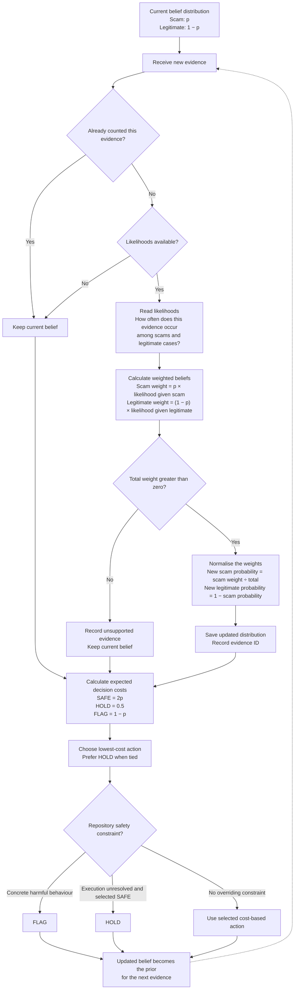

# V2 belief updates and cost-based decisions

The diagram below describes the implemented probability and decision-policy modules.
**These modules are not yet connected to the live conversation runner.** The live
runner currently applies scoped repository and wallet safety rules.

## Probability distribution

[bayes.ts](./bayes.ts) maintains two states: scam and legitimate. Their
probabilities sum to one. An update needs the current prior and both
`P(evidence | scam)` and `P(evidence | legitimate)`.

- Repeated evidence IDs do not update the belief again.
- Missing likelihoods leave the belief unchanged; the agent does not invent values.
- Zero total weight returns `unsupported_evidence` and preserves the prior.
- Correlated evidence needs likelihoods conditioned on evidence already used;
  different evidence IDs alone do not establish independence.

## Cost-based policy

[decision-cost.ts](./decision-cost.ts) calculates the expected cost of each action.
[decision-policy.ts](./decision-policy.ts) supplies the student-assumed relative
costs for ordinary hiring:

| Action | Cost if scam | Cost if legitimate | Expected cost |
| --- | --- | --- | --- |
| SAFE | 2 | 0 | `2p` |
| HOLD | 0.5 | 0.5 | `0.5` |
| FLAG | 0 | 1 | `1 − p` |

HOLD represents a delay of up to 24 hours. These are assumed cost units, not
measured losses; urgent hiring requires a separate cost model.

| Scam probability | Cost-only action |
| --- | --- |
| Below 25% | SAFE |
| 25%–50%, including both boundaries | HOLD |
| Above 50% | FLAG |

Repository safety constraints can override the cost-only action: concrete harmful
behaviour requires FLAG, and unresolved execution prevents SAFE. These overrides
do not numerically change the probability. A clean scoped inspection still needs
matching verified assessment authorisation before execution can be recommended.

**Evidence changes the probability. Costs change the action boundary.**

For live commands, inspection limits, authorisation workflows, and reports, see
the [project README](../../README.md).
