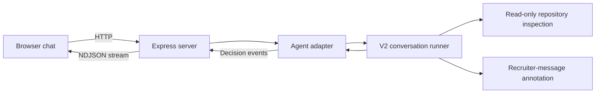

# V2 demo app

The browser UI, Express server, demo sessions and demo tests live here. V2's
analysis and policy modules remain in the parent directory. This is a folder
boundary within the existing project, using its package manifest and lockfile;
it is not a separately deployed service or a copy of the agent.

```text
demo-app/
  server.ts                 Express routes, streaming and local session storage
  agent-adapter.ts          The demo's only imports of V2 agent modules
  public/
    index.html
    demo.css
    demo.js
    real-examples.json        Two sourced recruiter messages for manual simulation
  tests/
    server.test.ts
    agent-adapter.test.ts
```

The connection is:



Run from the **project root**, with the existing credentials in the root `.env`:

```bash
npm run demo:v2
```

Open **http://127.0.0.1:3210**. The server serves only the four allowlisted browser
assets. Credentials and agent source are never served as static files.

When Recruiter is selected, two suggestions fill the composer without sending:
case 44 at t2 (scam-labelled, suspected) and case 2 at t4 (legitimate-labelled),
based on `data/real/july-conversations.json`. The legitimate message is copied
exactly. Case 44 is adapted with the previously tested
`https://github.com/bitangels-lab/auron/` URL, which was not in its source message;
the UI marks this adaptation. The original dataset is unchanged. Source IDs and dataset
labels are UI metadata and are not included in agent requests. These are demo
examples, not independently confirmed outcomes or held-out evaluation. Use a new
conversation to compare them without carrying over the other example's context.

The right-hand activity flow follows actual send, acceptance and decision events.
It highlights source inspection only after the runner emits `inspection_triggered`;
it does not simulate individual file reads or estimated progress. Candidate replies
show context recording with analysis/inspection skipped. Errors stop the animation,
and the active-step motion is disabled with reduced-motion preferences.

## API boundary

- `POST /api/chat`: one recruiter/candidate message and an optional `session_id`.
  Returns `started`, `decision`, and `complete` events as newline-delimited JSON.
- `DELETE /api/chat`: `{ "session_id": "..." }` clears one chat.
- `POST /api/replay`: preserves the original fresh-conversation replay endpoint.
- The adapter validates and projects messages before agent input, caches exact
  prior calls and reconstructs the existing agent state. It does not implement
  independent scam rules. Candidate replies trigger no model or inspection calls.

The existing loopback Host/Origin checks, bounded JSON input, one active analysis,
eight-session cap, 30-minute expiry, and 20-message chat limit remain. There is no
public authentication or production deployment in this demo. Agent prompts,
safety boundaries, probability/cost assumptions and report schemas are unchanged.

Run all core and demo checks with `npm run check:v2`. The relocated demo tests
are included in `npm run test:v2`; they do not need credentials or live APIs.

See the [V2 README](../README.md) for full API behaviour and current model limits.
